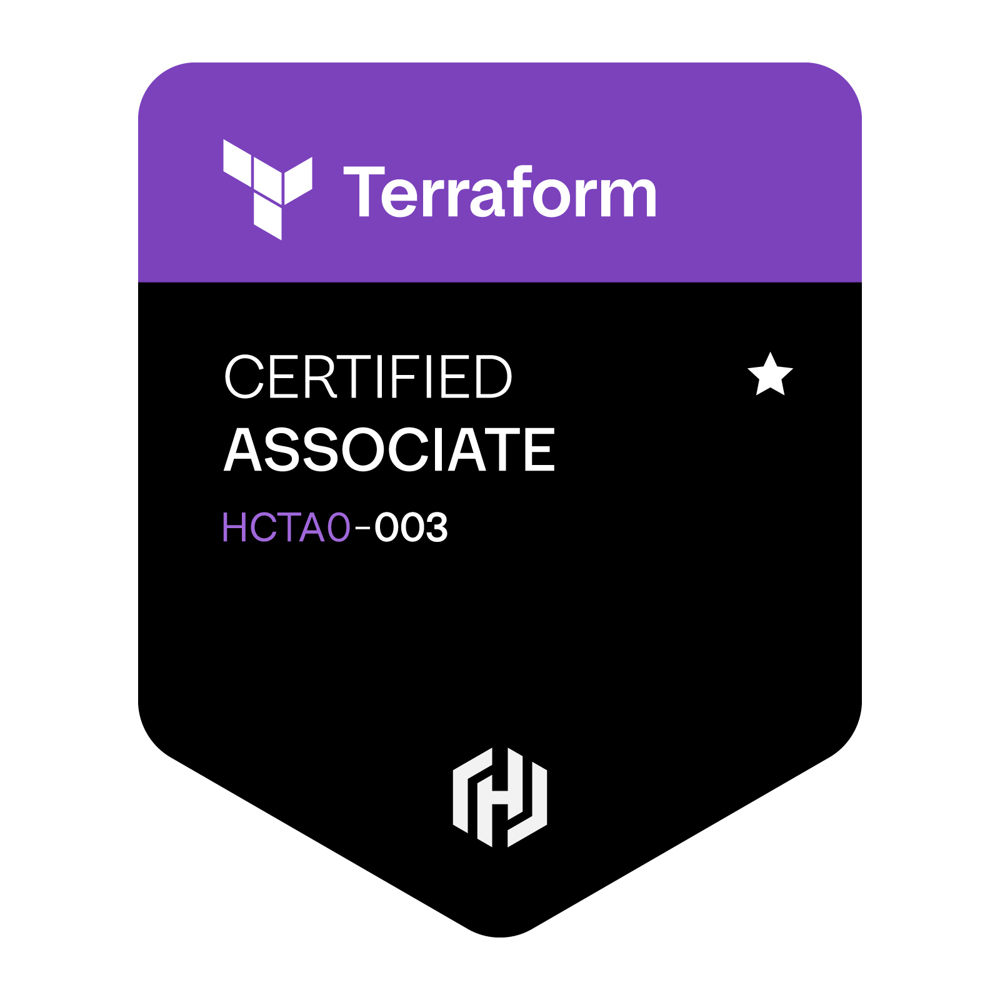

Hello there! I am Kyle, a DevOps/Software Engineer that enjoys working with a wide variety of technologies. I co-founded Cloud City Computing and I'm the founding engineer at PorchOps. Please feel free to connect with me!

### Links

  

### What I'm Building

  
  

### Focus

Most of my work sits in the infrastructure underneath agentic AI. I build the IaC and CI/CD that lets teams ship through automated deployments, allowing them to focus on the code and not the infrastructure. That has meant production work across all three major cloud providers: an agent platform on AWS AgentCore with GitHub Actions pipelines and CDK infrastructure, managed hosting on Azure, and a company-wide Gemini Enterprise rollout on GCP.

Beyond the pipelines, I spend a lot of time on observability and guardrails. AI is unpredictable, so the real value comes from knowing how to use it, not just vibe coding. Traces, standards, automated infrastructure: all of them are overlooked but bring the most leverage to agentic development and deployment. Supporting teams with these practices helps deliver better products, so nobody has to choose between moving fast and doing it right.

### Technologies

|  |  |
| --- | --- |
| **Agentic AI Infra** |    |
| **Cloud** |    |
| **IaC &amp; Containers** |        |
| **CI/CD &amp; Observability** |        |
| **Languages** |     |
| **Backend** |     |
| **Data** |       |

### Certifications

  
  &nbsp;&nbsp;
  

